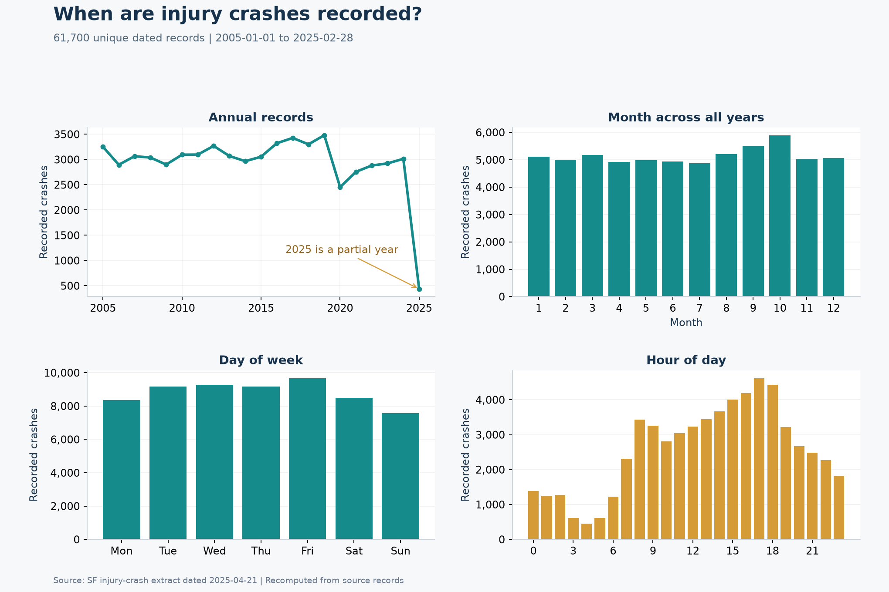
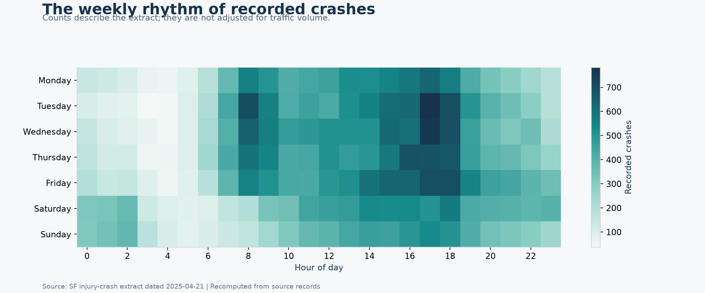
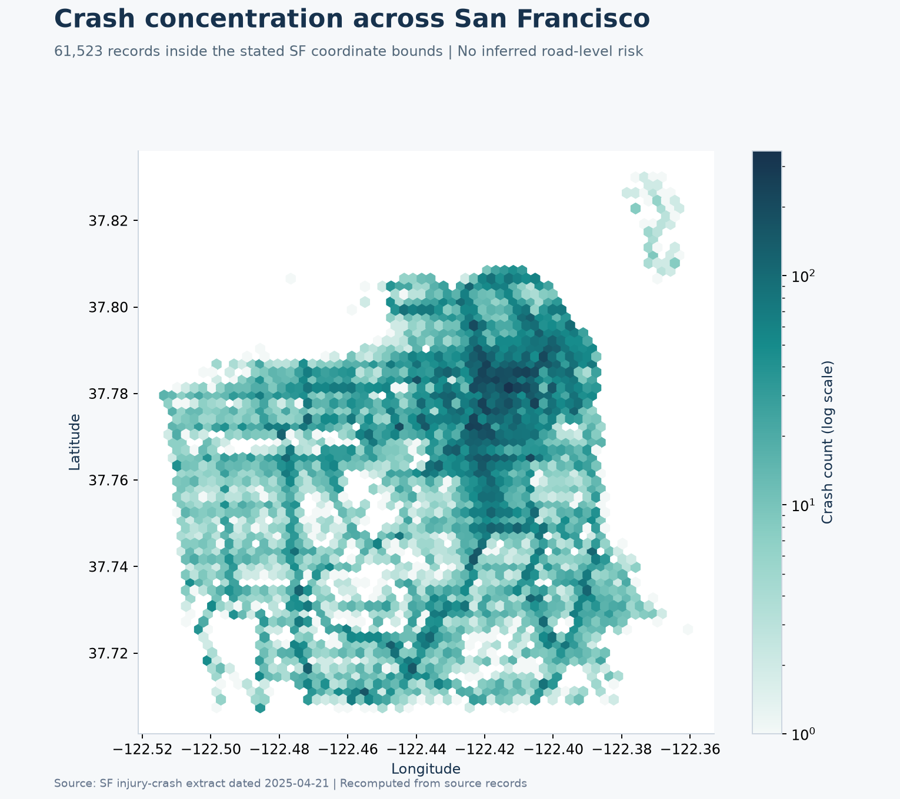
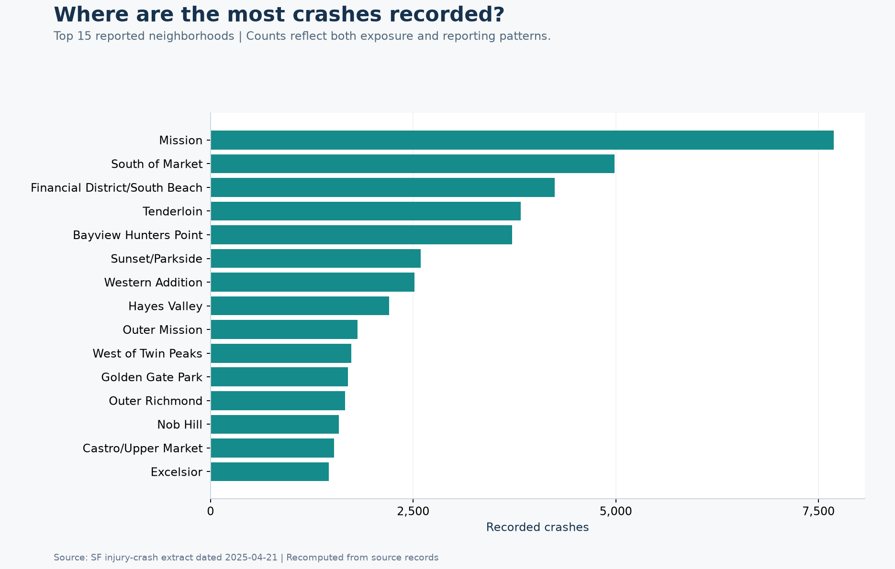
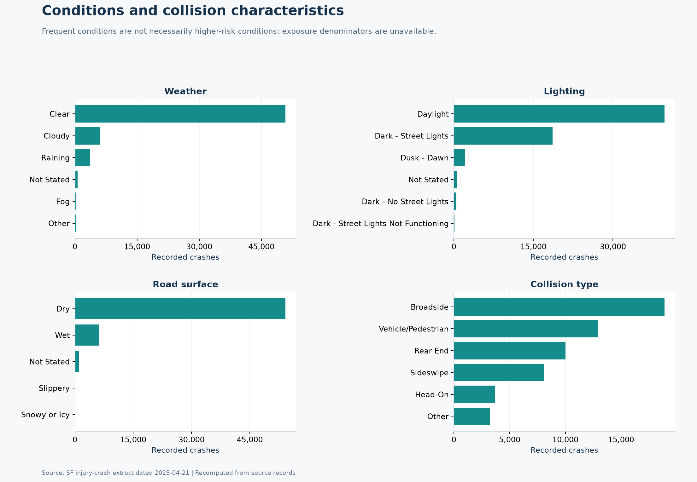
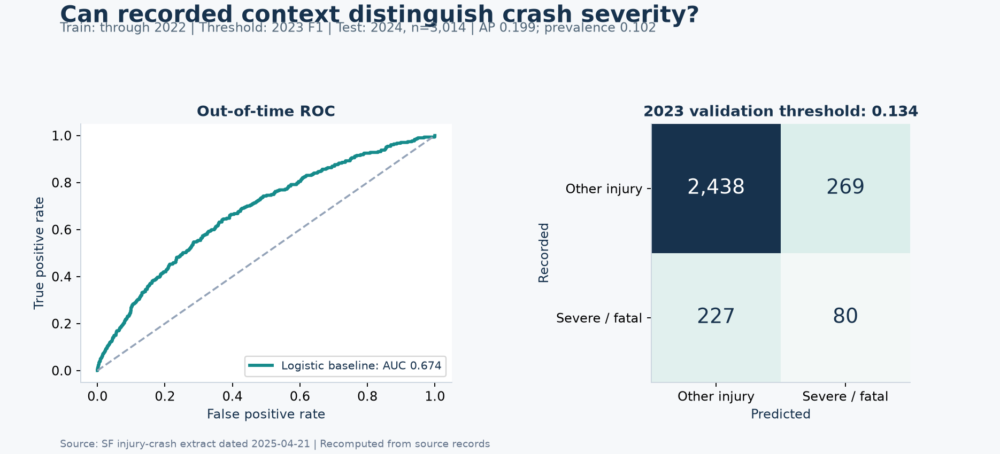
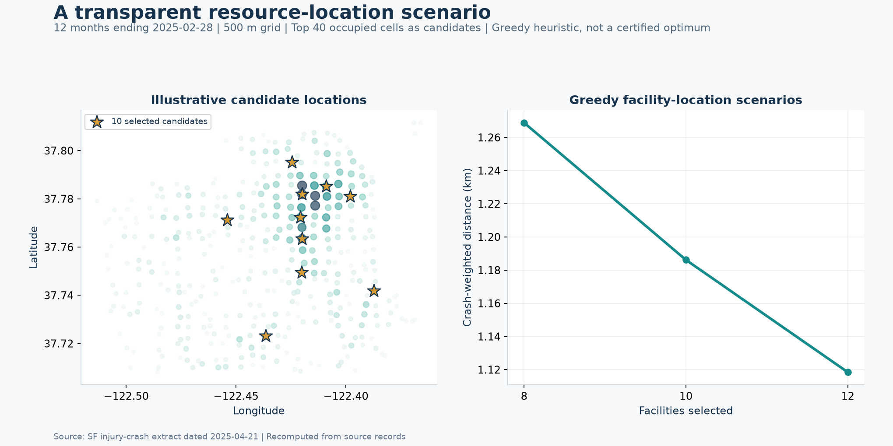

# CrashSight SF

A reproducible view of San Francisco injury crashes: when they occur, where they concentrate, and how location scenarios change service distance.

## Project participation

This was a collaborative group project, and I actively contributed to every stage of its development.

Original team repository: [sunaminusone/CrashSight-SF](https://github.com/sunaminusone/CrashSight-SF). Original author and repository maintainer: Meixuan Li (Suna). This portfolio edition preserves the original notebooks, outputs, and [project documentation](docs/ORIGINAL_README.md), and adds a separately documented local reproduction.

## The question

Crash records can help planners identify recurring patterns and compare resource-location scenarios. The useful decision is where to investigate or evaluate coverage next. Record counts alone cannot establish crash risk per trip or prove that a proposed site will improve emergency response.

## Recomputed findings

| Measure | Local result |
|---|---:|
| Source records | 61,702 |
| Unique records with usable dates | 61,700 |
| Records within the stated SF coordinate bounds | 61,523 |
| Date range | 2005-01-01 to 2025-02-28 |
| 2024 severity-baseline ROC AUC | 0.674 |
| 2024 average precision | 0.199 |
| Severe/fatal prevalence in 2024 test records | 10.2% |

The extract includes only part of 2025. Its lower annual count should not be interpreted as a full-year improvement.





## Geographic and contextual patterns

The refreshed charts use a navy, teal, and gold visual system with consistent titles, units, and data-source notes. Counts by weather, lighting, or neighborhood reflect the volume of recorded events; differences also depend on traffic exposure and reporting.







## A baseline with a real time boundary

The portable model classifies **severe/fatal versus other injury among already-recorded injury crashes**. It is a separate task from the original notebook's grid-hotspot classification.

- Fit a logistic regression on records through 2022.
- Use 2023 only to select a probability threshold by F1.
- Evaluate once on 2024 (3,014 records).
- Use recorded month, weekday, hour, weather, lighting, road surface, collision type, and neighborhood. Exclude injury counts, deaths, severity labels, and density features derived from the target.
- Fit imputation, encoding, and scaling on training data only.

The model distinguishes severity using reported crash context. Because some context is observed during incident reporting, this is not a pre-crash early-warning model. The validation threshold is a demonstration choice, not an operational recommendation.



## Resource-location scenarios

The siting example uses a 500 m grid over the final 12 months of the extract. Forty high-count occupied cells form an illustrative candidate set. A deterministic greedy heuristic selects 8, 10, or 12 locations to reduce crash-weighted straight-line distance.

| Candidate facilities opened | Crash-weighted mean distance | Within 1 km |
|---|---:|---:|
| 8 | 1.27 km | 46.3% |
| 10 | 1.19 km | 52.7% |
| 12 | 1.12 km | 59.9% |

Candidate sites are geometric scenarios, not verified parcels or existing emergency stations. Distances approximate geographic proximity and do not include road travel time, staffing, dispatch constraints, or equity requirements. A greedy solution is not a certified global optimum.



[Open the interactive map](https://raw.githack.com/xkong585/CrashSight-SF/main/results/refreshed/facility_map.html) · [Download the map HTML](results/refreshed/facility_map.html) · [Inspect scenario results](results/refreshed/facility_comparison.csv)

## Reproduce locally

```bash
git clone https://github.com/xkong585/CrashSight-SF.git
cd CrashSight-SF
python3.12 -m venv .venv
source .venv/bin/activate
pip install -r requirements-reproduction.txt
python scripts/reproduce.py
```

The 2025-04-21 source ZIP is included in `data/`. The script writes charts, aggregate tables, held-out predictions, and a checksum-bearing [run summary](results/refreshed/run_summary.json) to `results/refreshed/`. The [executed local notebook](notebooks/Local_Reproduction.ipynb) provides the same entry point. It does not require Google Drive or Colab.

## Repository guide

- `scripts/reproduce.py`: portable local analysis and figure generation.
- `notebooks/Local_Reproduction.ipynb`: executed reproduction, with recorded output.
- `notebooks/SFCrashSight_*.ipynb`: original team Colab notebooks, preserved as historical source.
- `results/refreshed/`: recomputed results used on this page.
- Other `results/` folders: original outputs, retained for context.
- `docs/REPRODUCTION.md`: what was rerun, changed, and not revalidated.
- `docs/SOURCE_SNAPSHOT.json`: source commit and change provenance.

## Next steps

Add traffic-volume denominators, evaluate calibration and subgroup error, test geographic holdouts, and replace straight-line distances with a road network before considering operational use. The original Moran/LISA and TSP outputs have not been revalidated by this portable workflow.
